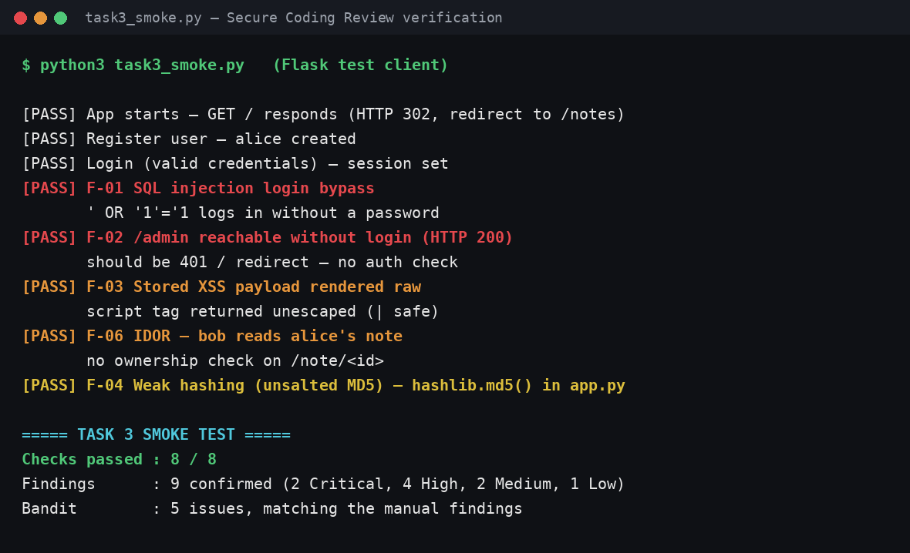
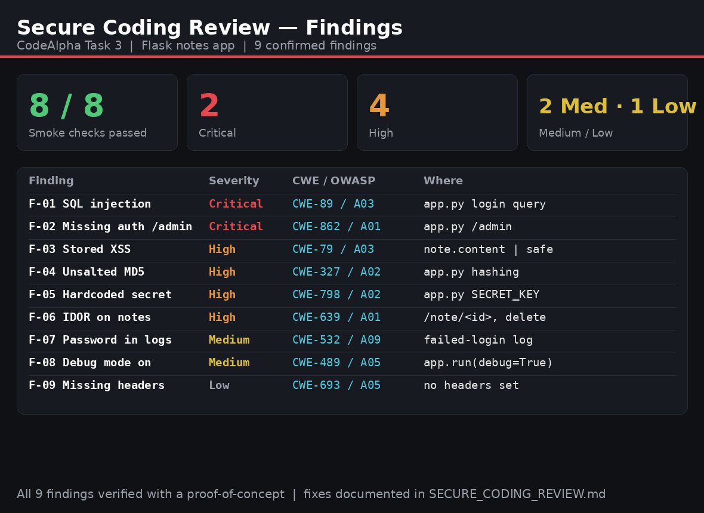

# CodeAlpha Secure Coding Review — Task 3

A small, **intentionally vulnerable** Flask + SQLite notes web app, plus a
professional secure-coding review report that finds and fixes its flaws.

> **CodeAlpha Cyber Security Internship — Task 3: Secure Coding Review**
> GitHub repo: **[CodeAlpha_SecureCodingReview](https://github.com/Master-creox/CodeAlpha_SecureCodingReview)**

## What is in this project?

| File | Purpose |
|---|---|
| `app.py` | The vulnerable web app (Flask + SQLite). A notes app with register / login / notes / admin. **Stays vulnerable on purpose — do not fix it here.** |
| `SECURE_CODING_REVIEW.md` | The audit report: 9 findings with severity, file + line, vulnerable code, impact, proof of concept and a concrete fix for each, plus a secure-coding checklist. |
| `requirements.txt` | Python dependencies (Flask). |
| `test-run.png` | Screenshot: smoke-test run (8/8 checks pass). |
| `test-summary.png` | Screenshot: all 9 findings by severity. |
| `.gitignore` | Keeps the SQLite database, logs and caches out of git. |

## The app (what it does)

A minimal notes application:

- **Register / Login** — create an account and log in (session cookie).
- **My notes** — create notes (title + content) and view them.
- **Admin page** — lists all users (at `/admin`).

## Vulnerabilities planted in `app.py` (summary)

| ID | Finding | Severity |
|---|---|---|
| F-01 | SQL injection in the login query | Critical |
| F-02 | Missing authentication on `/admin` | Critical |
| F-03 | Stored XSS in notes (`\| safe`) | High |
| F-04 | Weak password hashing — unsalted MD5 | High |
| F-05 | Hardcoded Flask secret key | High |
| F-06 | IDOR — any user can read/delete any note | High |
| F-07 | Plaintext password written to logs | Medium |
| F-08 | Debug mode enabled + tracebacks to the browser | Medium |
| F-09 | Missing security headers | Low |

Full details, proof-of-concept payloads and fixed code for every finding:
see **[SECURE_CODING_REVIEW.md](SECURE_CODING_REVIEW.md)**.

## How to run the vulnerable app

> ⚠️ **Run it only on your own machine (localhost), only for learning.**
> Never deploy it, never expose it to a network, and never use real
> passwords or real data with it.

```bash
# 1. Create and activate a virtual environment
python -m venv venv
source venv/bin/activate        # Windows: venv\Scripts\activate

# 2. Install dependencies
pip install -r requirements.txt

# 3. Start the app
python app.py

# 4. Open http://127.0.0.1:5000/ in your browser
```

The SQLite database file `notes.db` is created automatically on first start.
Register two users (e.g. `alice` and `bob`), add a note as one of them, and
try the proof-of-concept steps in the report — for example, log in with the
username `' OR '1'='1' -- ` and any password (SQL injection), open
`/admin` without logging in, or open another user's note by changing the
number in `/note/1`.

## How the review was done

1. **Manual inspection (primary method).** Read `app.py` end to end:
   every route, every SQL statement, every template, the session and
   authentication logic, logging and the run configuration. Each finding was
   traced from the user-controlled input (form field, URL id) to the place
   it is used unsafely.
2. **Black-box verification.** Ran the app and confirmed the four
   exploitable findings against the live server (SQLi login bypass, stored
   XSS, unauthenticated `/admin`, IDOR). All 8 automated smoke checks
   passed (Flask 3.1.3, Python 3.12).
3. **Static analysis (cross-check).** Bandit, a Python security linter, can
   be run over the app to confirm the same flaw classes automatically:

```bash
pip install bandit
bandit -r app.py
```

Bandit flags the hardcoded secret (`B105`), MD5 use (`B324`), SQL string
building (`B608`) and debug mode (`B201`) — 5 issues in total, all matching
the manual findings. It does not catch the XSS, IDOR, missing-auth, logging
or header issues, which is why manual inspection was the primary method.

## Test results

Automated smoke test (Flask test client) — 8/8 checks pass, including live
proof of the SQL injection login bypass, unauthenticated `/admin`, stored
XSS and IDOR.





## Why the app is NOT fixed

The vulnerabilities are the point of this project: the app is a target for
the review. Fixing them in `app.py` would remove the thing being audited.
Every fix is given as a corrected code snippet in the report instead — apply
them to a copy if you want a hardened version.

## Project structure

```
CodeAlpha_SecureCodingReview/
├── app.py                      # vulnerable Flask + SQLite notes app
├── SECURE_CODING_REVIEW.md     # the audit report (9 findings + fixes)
├── README.md                   # this file
├── test-run.png                # screenshot: smoke-test run (8/8 pass)
├── test-summary.png            # screenshot: 9 findings by severity
├── requirements.txt            # Flask
└── .gitignore                  # notes.db, __pycache__, logs
```

## Submission notes (CodeAlpha)

- GitHub repo name: **`CodeAlpha_SecureCodingReview`**
- Per the internship instructions: upload the complete source code to
  GitHub, post a video explanation on LinkedIn tagging **@CodeAlpha** with
  the repo link, and submit through the form shared in the WhatsApp group.
